# Agentic Commerce

Traditional sellers choose products, suppliers, and prices using their intuition and prior experience. They don't collect data about the performance of their sales, so they can't evaluate or improve their choices and decisions.

We propose agentic commerce, an approach that relies on data, business rules, and agentic AI to select winning products and reliable suppliers, estimate competitive prices, and monitor commerce performance to improve decision-making.

|E-commerce platform| Markets | Type of products | Suppliers | Logistics |
| --- | --- | --- | --- | --- |
|  SHOPEE | 🇸🇬 Singapore (main) - 🇹🇼 Taiwan - 🇹🇭 Thailand - 🇲🇾 Malaysia - 🇻🇳 Vietnam | K-beauty products | 🇰🇷 Korean suppliers,  Alibaba, etc. | 🚚 EXPRESS Couriers -  Shopee logistics service|

### Toolbox
<p>
  
  
  
  
  
  
  
</p>

|tool | version |
| --- | --- |
| python | 3.12.3 |
| pandas | 3.0.3 |
| streamlit | 1.58.0 |
| torch | 2.11.0 |
| langchain | 1.0.3 |

### Project components
1. Product discovery and selection

    It starts by preparing a large list of the best-selling products on Shopee in the specified markets. Then, it ranks the products using collected data and mathematical formulas. Finally, it recommends the top 10 products to be listed on Shopee. These products are the most likely to provide a return on investment.

    The product rankings are based on product costs, market prices, estimated profit, market demand, competition, social media popularity, ease of logistics, product compliance and regulations, size, and weight.

    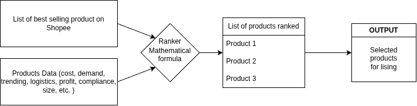

2. Supplier selection

    From a list of suppliers, the agent ranks and selects the most reliable suppliers using their data and mathematical formulas.

    The selection criteria are supplier product costs, location, certifications, MOQ (minimum order quantity), response rate, average number of sales, lead time, and product catalog.

    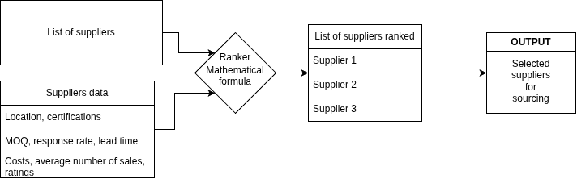

3. Listing generation AI Agent

    Listing our products on Shopee requires an engaging image, title, specifications, description, keywords, and a Q&A section. To generate [optimized listings](#listing-dashboard) that stand out from the competition, I use specialized e-commerce listing agents.
    
    The process starts by analyzing our competitors' listings and extracting relevant patterns and insights about how listings should look and what engages customers. It then generates personalized listings for every product.

    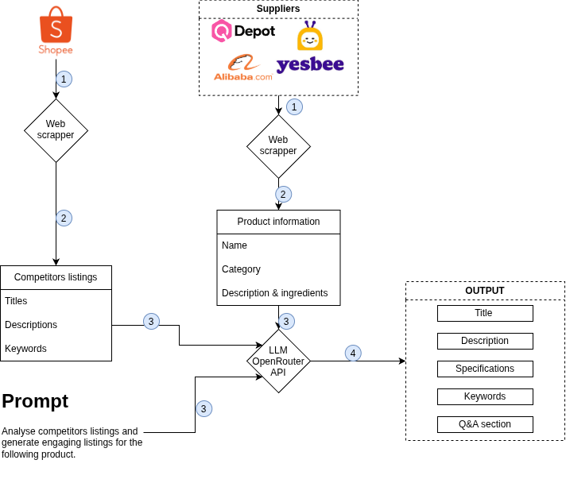

4. Product pricing 
    
    The objective is to estimate competitive prices for our products on Shopee. The process starts by extracting our competitors' prices and determining a competitive price range. It then uses a mathematical formula that includes the necessary costs, rates, fees, commissions, and profits to estimate the final price.

    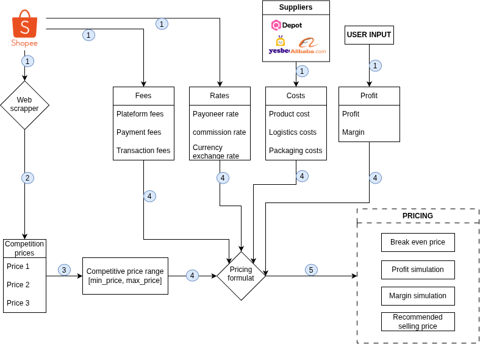

4. Marketing dashboard

    It extracts marketing data from the Shopee platform and generates a dashboard that summarizes the [marketing results](#marketing-agent---marketing-dashboard).

    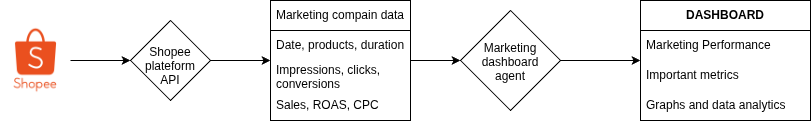
    
6. Marketing analytics AI Agent

    This is a multi-stage RAG system. Its objective is to use an AI marketing expert to analyze our marketing data, [generate a report](#marketing-analytics-agent---marketing-report-and-decision-making), and then propose practical recommendations to improve our marketing results.

    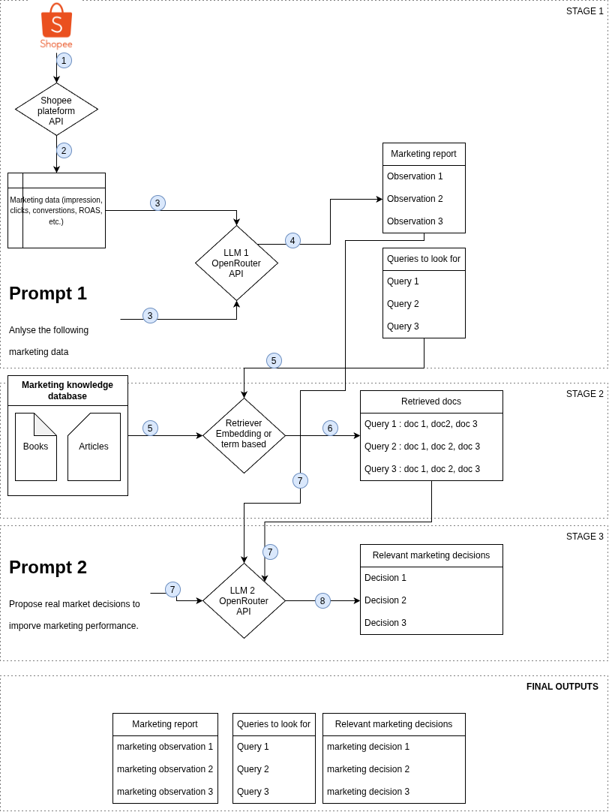

### Project structure

```text
agentic-commerce/
├── agents/                   # Product, supplier, pricing, listing, and marketing agents
│   ├── embeddings/           # Embedding integrations
│   ├── listing_generation/   # Listing generation, evaluation, and guardrails
│   ├── marketing_analytics/  # Marketing analysis and RAG retrieval
│   │   └── knowledge_base_builders/
│   ├── pricing_optimization/
│   ├── products_scoring/
│   ├── prompts/              # LLM prompts
│   └── supplier_scoring/
├── data/                     # Input data and generated agent outputs
├── data_pipeline/            # Product collection and scraping
│   ├── collectors/
│   └── config/
├── documentation/            # Project notes, guides, and screenshots
├── notebooks/                # Exploratory and test notebooks
├── pages/                    # Streamlit pages for the dashboards
├── ressources/               # Images and RAG reference documents
├── src/                      # Shared utilities and UI components
├── tests/                    # Agent and component tests
├── app.py                    # Streamlit application entry point
├── config.yaml               # Application configuration
├── requirements.txt          # Python dependencies
└── Pipfile                   # Pipenv dependency configuration
```


### Project screens

#### Product selection agent - Product scoring dashboard
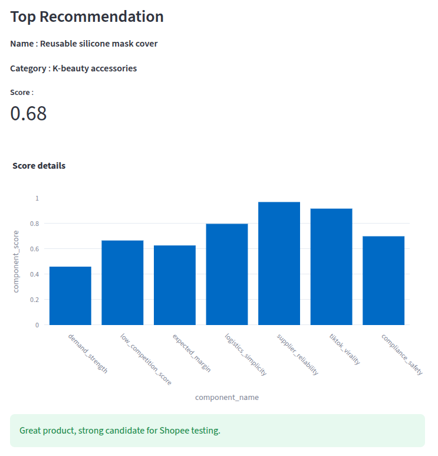

### Supplier selection agent - Supplier scoring dashboard
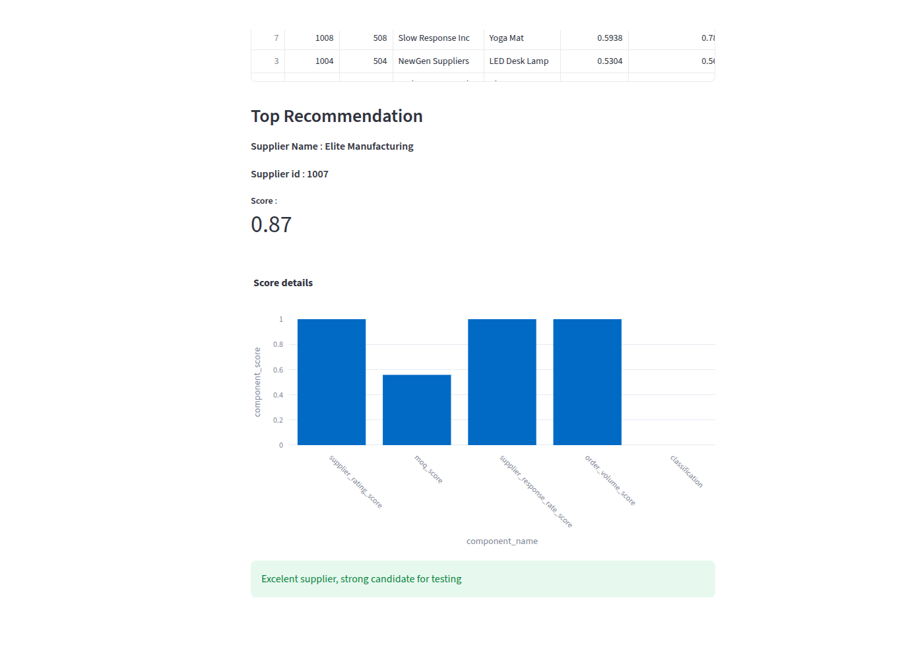

#### Dynamic pricing agent - Pricing dashboard

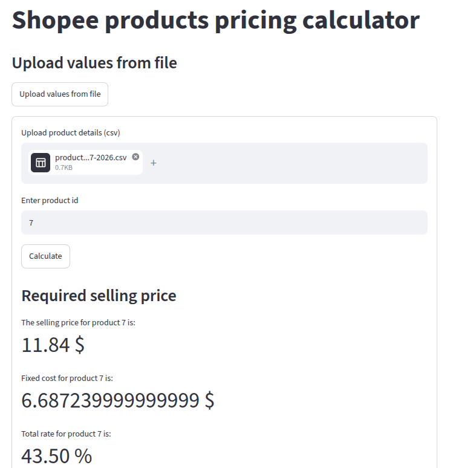
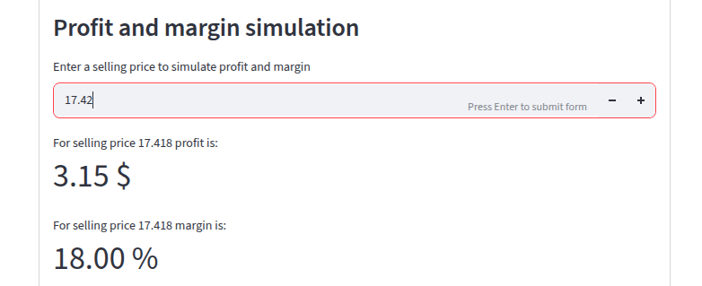
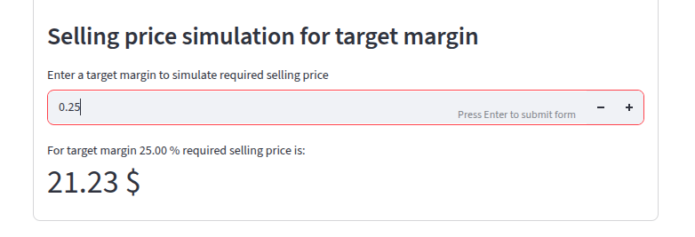

#### Marketing Agent - Marketing dashboard

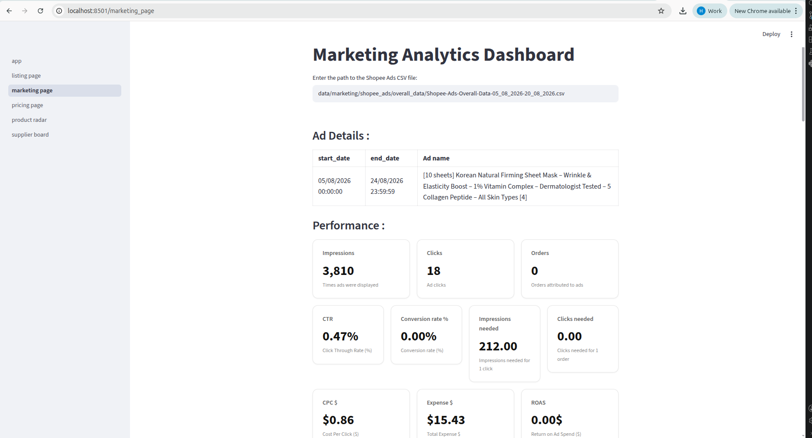
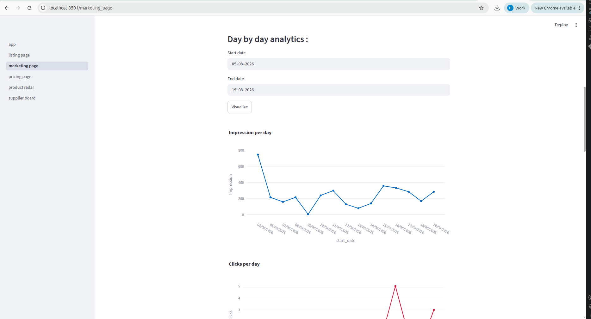
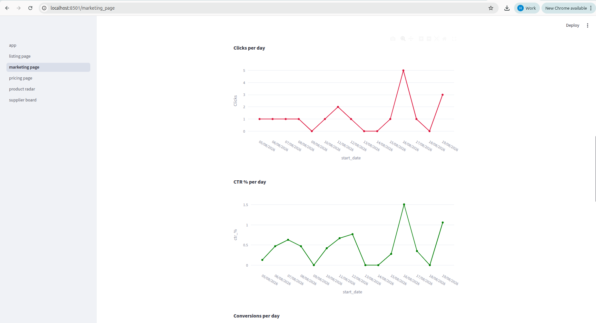

#### Listing Dashboard
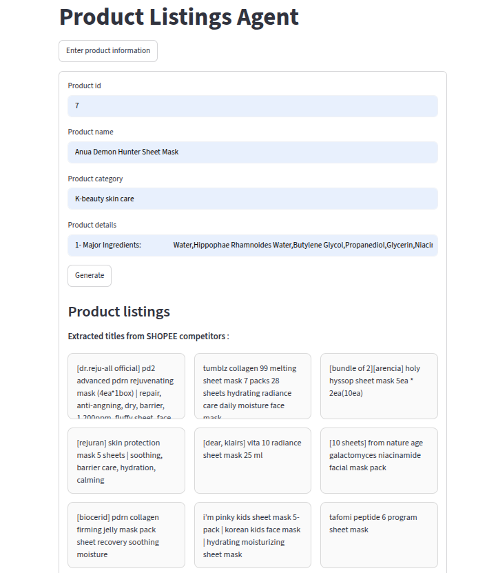

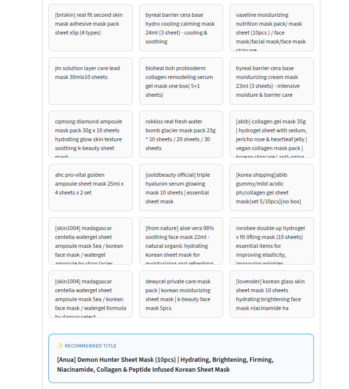

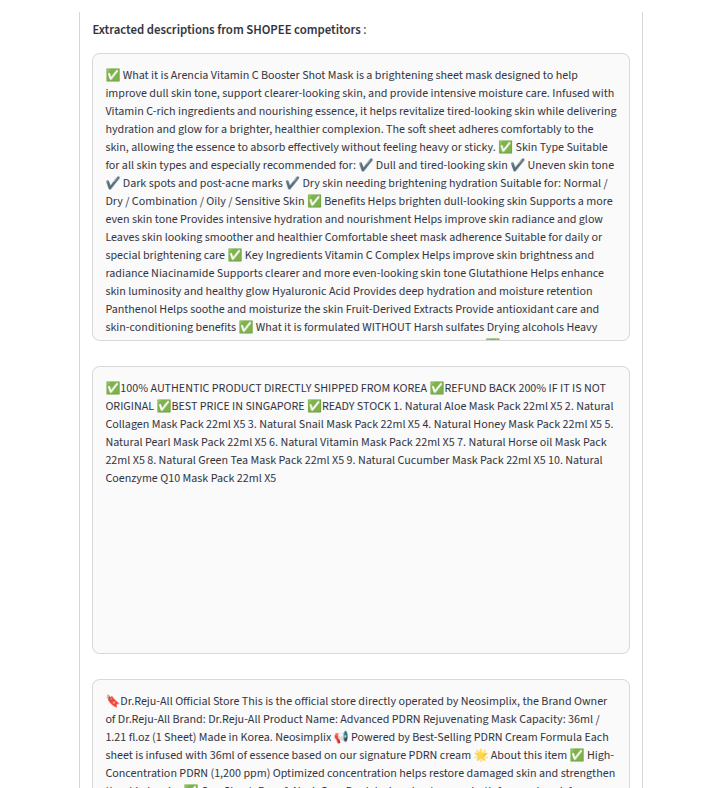

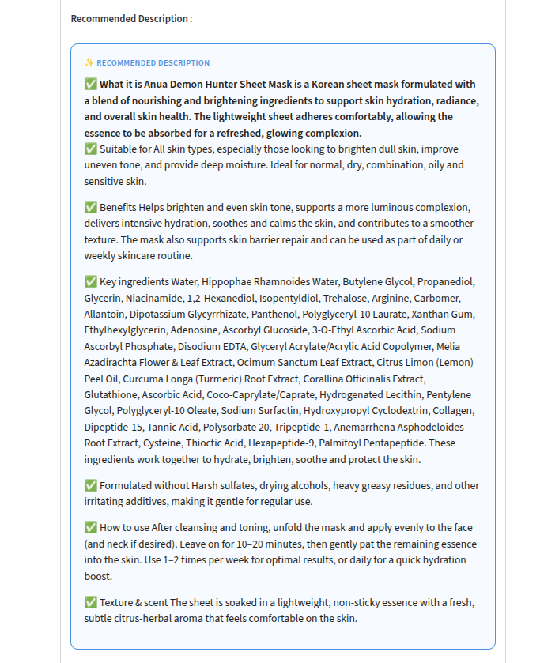

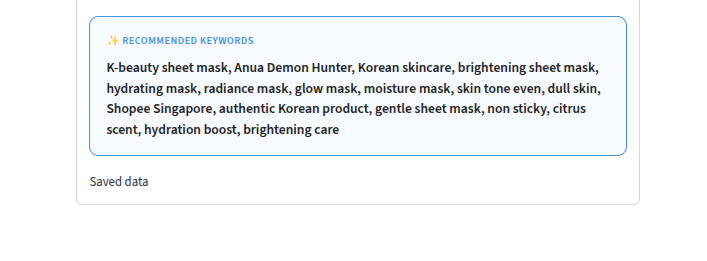

#### Marketing Analytics Agent - Marketing report and decision making
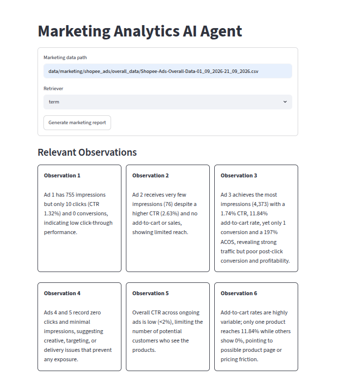

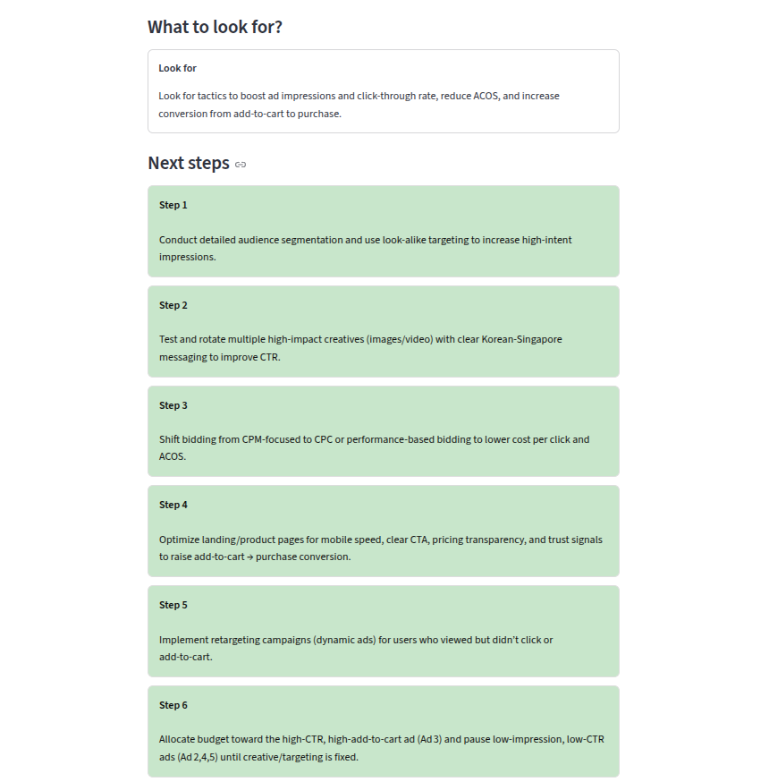
